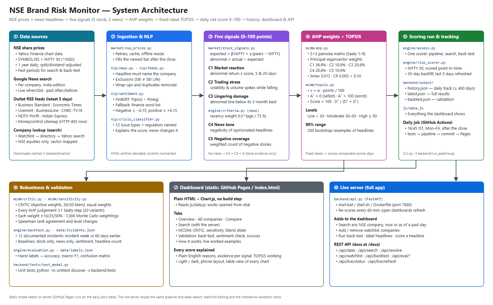

# NSE Brand Risk Monitor (AI + MCDM Brand Image Risk Index)

A daily **brand risk score from 0 to 100** for companies listed on the **National Stock Exchange of India (NSE)**, by default the 50 companies of the **NIFTY 50**. The score is built from two kinds of evidence:

1. **Stock effect.** How unusually the share price behaves *after removing what the NIFTY 50 and the company's sector peers did*.
2. **News.** How negative the recent headlines are, when there are any, scored with **FinBERT** or a finance word list.

These five signals are weighted with **AHP** and combined with **TOPSIS**. The score is stored every trading day so each company can be tracked over time. Each score is explained in plain English, stress-tested (CRITIC weights, sensitivity analysis) and validated with a back-test on documented incidents.

[](https://se23uari120.github.io/brand-risk-index/)
[](https://github.com/se23uari120/brand-risk-index)

* **Online demo (stored results, updated every weekday):** https://se23uari120.github.io/brand-risk-index/. Company Search can be added to it for free with a Render server (see [Hosting](#hosting)).
* **Full app (live re-scoring, Company Search, validation tools):** run it locally with the two commands below, or host it (see [Hosting](#hosting))

> Not investment advice. This is a monitoring tool for brand and reputation risk.

(The block between the `---` lines at the top is only used if the app is hosted on Hugging Face Spaces.)

---

## Contents

- [Quick start](#quick-start)
- [What you see](#what-you-see)
- [How the score works](#how-the-score-works)
- [Robustness and validation](#robustness-and-validation)
- [Daily tracking and the live server](#daily-tracking-and-the-live-server)
- [Hosting](#hosting)
- [Architecture](#architecture)
- [Command line](#command-line)
- [Configuration](#configuration)
- [Project structure](#project-structure)
- [REST API](#rest-api)
- [Changes compared with the report](#changes-compared-with-the-report)
- [Data sources and limitations](#data-sources-and-limitations)

---

## Quick start

Needs **Python 3.10+** and **Git**.

**Windows (Command Prompt):**
```bat
git clone https://github.com/se23uari120/brand-risk-index.git
cd brand-risk-index
setup.bat
start.bat
```

**macOS / Linux:**
```bash
git clone https://github.com/se23uari120/brand-risk-index.git
cd brand-risk-index
chmod +x setup.sh start.sh
./setup.sh
./start.sh
```

Then open **http://localhost:8000**. `setup` runs once and installs PyTorch (CPU), FinBERT, FastAPI and the core packages into `.venv`. After that only `start` is needed. FinBERT (~440 MB) downloads on the first start, and the first scoring pass takes about 2 minutes.

**With Docker:** `docker build -t brand-risk .` then `docker run -p 7860:7860 brand-risk` → http://localhost:7860

**Without the server:** opening `index.html` directly works too, showing the stored results in `js/data.js`. To refresh them you only need three packages:

```bash
pip install -r backend/requirements.txt
```

```bash
py -3 backend/run_pipeline.py
```

---

## What you see

| Tab | What it shows |
|---|---|
| **Overview** | Counts of High / Moderate companies, the highest-risk companies with a one-line reason and their main issue, the biggest risers this week, the most negative news, what the bad news is about (issue types) and average risk by sector. |
| **All companies** | Searchable, sortable table: score, level, 1-week change, company-specific share move, news count, 30-day trend. |
| **Company panel** (click any company) | The score in plain English, a 90% range, the main issue and regulators named, the five signals with their evidence, the risk history, price vs NIFTY 50, the company-specific performance line, the headlines with sentiment and issue type, and the full TOPSIS calculation. |
| **Search** *(server)* | Any NSE-listed company (name, brand or symbol), live or **as of a past day**. It is scored exactly like the tracked companies and can be added to the watchlist. |
| **Compare** | Up to four companies side by side. |
| **MCDM** | AHP vs CRITIC vs blended vs equal weights, an interactive blend slider, the CRITIC inputs, judgement perturbation, one-at-a-time weight changes and 1,000 Monte Carlo weightings. |
| **Validation** | The incident back-test with baselines, the sentiment check against human labels, a one-headline scorer and where the news comes from. Labelling, re-running the back-test and the scorer need the server. |
| **How it works** | The whole method explained with today's real numbers. AHP weights are recomputed in the browser, and there is a TOPSIS worked example for any company. |

It works on phones, in light and dark mode, and every chart has a table view. With the server running, a green **Live** badge appears in the header. Click it to re-score now.

---

## How the score works

A brand problem shows up in two places: **investors sell the shares more than the market explains**, and **the press writes negative stories**. The monitor measures both, and **removes market-wide and sector-wide moves first**, because a falling sector is not a problem with one brand.

```
 NSE prices (Yahoo) ──► two-factor model ──► C1 Market reaction ─┐
                                             C2 Trading stress   │
                                             C3 Lingering damage ├─► AHP weights ─► TOPSIS (fixed ideals) ─► score 0–100 ─► level
 Google News + outlet feeds ──► relevance ──► C4 News tone        │                                              │
      ──► sentiment (FinBERT) + issue type    C5 Negative coverage┘                                              ▼
                                                                                              daily history · dashboard · API
```

### Step 1: Collect

* **Prices:** one year of daily split- and dividend-adjusted closes and volumes from Yahoo Finance's public chart data for `SYMBOL.NS` and the NIFTY 50 (`^NSEI`). Past periods are downloaded for search and the back-test.
* **News:** a Google News search per company (live: last 50 days; past: `after:`/`before:`), plus, for the latest 3 days, the RSS feeds of Business Standard, Economic Times, Livemint, Hindu BusinessLine, CNBC-TV18, NDTV Profit and Indian Express.
* **Relevance:** a headline must name the company (with tuned name variants) and not a similarly named one (e.g. "SBI Life" for SBI). Market wrap-ups ("Sensex, Nifty fall…") and duplicates are dropped, and HTML entities are decoded.
* **Sentiment:** each headline is scored −1…+1 by **FinBERT** (`ProsusAI/finbert`: P(positive) − P(negative)), or by a transparent finance word list when FinBERT isn't installed. Headlines at ≤ −0.15 count as negative and ≥ +0.15 as positive.
* **Issue type:** a rule-based **crisis-event classifier** tags each headline: Theft & Crime, Regulatory Action, Fraud & Governance, Tax Dispute, Legal & Litigation, Data & Cyber, Safety & Product, Service Outage, Labour & Protest, Leadership Change, Financial Distress, ESG & Environment or Market & Earnings. It also records the regulators named (RBI, SEBI, USFDA, …). This explains the score; it does not change it.

### Step 2: The five signals (0–100 risk points each)

**Expected-return model (C1, C3).** This is estimated per stock over the 120 trading days that end 20 days before the scored day:

```
expected return = β · r_NIFTY + γ · (r_peers − r_NIFTY)        abnormal return AR = actual − expected
```

`r_peers` is the average of the company's sector peers on the watchlist (itself excluded; at least 3 tracked companies in the sector, otherwise γ = 0). Both coefficients are shrunk toward 1 (`0.67·b + 0.33`). σ is the stock's normal daily abnormal-return noise. So if every IT stock falls 5% on a sector-wide worry, Infosys's abnormal return is about zero.

**News weighting (C4, C5).** Each headline in the last 7 days has a recency weight `w = 0.5^(age / 72 h)`.

| # | Signal | Question | Formula → risk points | AHP weight |
|---|---|---|---|---|
| C1 | **Market reaction** | Did the shares fall more than the market and sector explain? | z₅ = CAR₅/(σ√5), z₂₀ = CAR₂₀/(σ√20) → `100·clip((max(−z₅,−z₂₀) − 1)/2)`: 0 down to −1σ, 50 at −2σ, 100 at −3σ | **36.9%** |
| C2 | **Trading stress** | Is it traded unusually nervously? | `½·clip((vol10/vol90 − 1)/1.5) + ½·clip((volume5/volume60 − 1)/2)`, × 0.25 if the stock is beating expectations | **10.9%** |
| C3 | **Lingering damage** | Has company-specific damage built up and stayed? | gap of the running Σ AR below its 3-month best, in units of σ√63 → `100·clip((gap − 1)/2)` | **20.6%** |
| C4 | **News tone** | How negative is the opinionated coverage? | `100 · Σ wᵢ·max(0,−sᵢ) / (Σ wᵢ + 2)` over **non-neutral** headlines. Routine neutral news does not water a crisis down; the 2 pseudo-headlines stop one stray story spiking it. 0 with no news. | **20.6%** |
| C5 | **Negative coverage** | How much negative coverage? | `100 · (1 − e^(−Σ wᵢ over negative headlines / 5))`: 1 fresh story → 18, 5 → 63, 10 → 86 | **10.9%** |

Stock behaviour carries **68%** of the weight and news **32%**. With no news, the score rests on stock behaviour alone.

### Step 3: AHP weights

| Row is … × as important as column | C1 | C2 | C3 | C4 | C5 | **Weight** |
|---|---|---|---|---|---|---|
| C1 Market reaction | 1 | 3 | 2 | 2 | 3 | **36.9%** |
| C2 Trading stress | 1/3 | 1 | 1/2 | 1/2 | 1 | **10.9%** |
| C3 Lingering damage | 1/2 | 2 | 1 | 1 | 2 | **20.6%** |
| C4 News tone | 1/2 | 2 | 1 | 1 | 2 | **20.6%** |
| C5 Negative coverage | 1/3 | 1 | 1/2 | 1/2 | 1 | **10.9%** |

The weights are the principal eigenvector, with λmax = 5.0133, CI = 0.0033, RI(5) = 1.12 and **CR = 0.0030 < 0.10**, so the judgements are consistent. Print it yourself with `py -3 backend/run_pipeline.py --eval-ahp`.

### Step 4: TOPSIS with fixed ideal points

`r = points/100` → `v = w·r` → **A⁺ = 0** (safest possible), **A⁻ = 100 on every signal** (worst possible) → `D⁺ = √Σ v²`, `D⁻ = √Σ (w − v)²` → **score = 100 · D⁺ / (D⁺ + D⁻)**.

* **Fixed ideals keep days comparable.** Classic TOPSIS uses the best and worst company of the day, which forces someone to 0 and someone to 100. With fixed ideals, a 40 today means the same as a 40 last month, and searched companies share the same scale.
* **One severe signal is not averaged away.** Market reaction alone at 100 gives about 53, where a weighted average would give 37. Every signal at 50 gives exactly 50.

### Step 5: Levels, actions and the 90% range

| Level | Score | Prescribed action |
|---|---|---|
| **High** | 50 – 100 | Executive crisis protocol: legal review, investor-relations alert, real-time PR response |
| **Moderate** | 30 – 50 | Assign an analyst, check disclosure (SEBI) obligations, draft a holding statement |
| **Low** | 0 – 30 | Background logging and routine monitoring; no escalation |

**90% range:** each score is recomputed for 200 bootstrap resamples of the week's headlines. The middle 90% shows how much the score depends on which stories happened to be picked up.

**Example (NSE close, 19 Nov 2026, FinBERT).** Tata Motors PV scored **75.9 (High, 90% range 74–78)**. The shares fell 13.4% more than the market and sector explained (−3.8σ) after Jaguar Land Rover cut its outlook, and 27 of 43 headlines were negative. TCS fell 4.1% that week, but its sector peers fell 4.5%, so all three of its stock signals are 0 and it stayed **Low** (21.8, from news alone).

---

## Robustness and validation

**Weights (MCDM tab; FinBERT sentiment, NSE close of 19 Nov 2026).** All rank-agreement figures are Spearman ρ with the AHP ranking. The figures change with each day's data; the MCDM tab always shows the current ones.

| Weighting | C1 | C2 | C3 | C4 | C5 | Rank agreement | Low / Moderate / High | Companies changing level |
|---|---|---|---|---|---|---|---|---|
| AHP | 36.9% | 10.9% | 20.6% | 20.6% | 10.9% | 1.000 | 46 / 3 / 1 | 0 |
| CRITIC (objective) | 11.9% | 12.4% | 24.5% | 20.2% | 31.0% | 0.913 | 36 / 11 / 3 | 15 |
| 50/50 blend | 24.4% | 11.7% | 22.6% | 20.4% | 21.0% | 0.972 | 37 / 11 / 2 | 10 |
| Equal | 20% | 20% | 20% | 20% | 20% | 0.966 | 39 / 9 / 2 | 12 |

* **The ranking is robust.** Moving any single AHP judgement one Saaty step keeps ρ ≥ 0.996, with at most 2 level changes. Changing any one weight by ±10% keeps ρ ≥ 0.998; even ±50% keeps ρ ≥ 0.978, with at most 4 level changes. Over 1,000 random weightings around the AHP weights the mean ρ is 0.987 (worst 5%: 0.963). Tata Motors PV and Titan are the top two under all four weightings above.
* **The levels are less robust.** CRITIC, the blend and equal weights put 40–51% of the weight on the two news signals, against 32% under AHP. (CRITIC weights each signal by how much it varies across companies and disagrees with the others, which today favours Negative coverage at 31%.) With FinBERT, heavily covered companies such as TCS, Infosys, ICICI Bank, IndiGo and ONGC carry a lot of negative coverage while their share-price signals stay low, so 9 to 12 companies move up from Low. Jio Financial and Shriram Finance, which are Moderate only because of their share price, drop to Low when Market reaction loses weight (CRITIC and equal weights). AHP gives the share-price reaction the most weight by design, so read a score near a level boundary together with its 90% range and its signal breakdown.

**Back-test (Validation tab).** There are 12 documented Indian incidents. Each company is scored point-in-time at the end of the incident week and on a control day 60 days earlier, from the same data, alongside four simpler methods:

| Method | Incident scored higher than control | Hit rate (≥ 30) | False alarms | Mean incident / control |
|---|---|---|---|---|
| **Risk index (stock + news)** | **92%** | **42%** | 17% | **41.5 / 10.5** |
| Stock signals only | 67% | 42% | 17% | 29.5 / 9.3 |
| News signals only | 83% | 0% | 0% | 16.4 / 2.1 |
| Average sentiment only | 83% | 17% | 0% | 22.1 / 1.9 |
| Number of headlines | 83% | – | – | 26.2 / 5.7 |

These results are from the word-list sentiment engine. Detected incidents: Paytm (RBI, 79), Kotak Mahindra Bank (RBI, 75), IIFL Finance (RBI, 79), Adani Enterprises (Hindenburg, 70) and Adani Green (US indictment, 80). Missed: events the market shrugged off, such as the Zomato uniform backlash (rolled back the next day) and the JLR cyber attack. With 12 incidents this shows direction, not statistical significance.

**Sentiment check.** With the server running, hand-label headlines in the Validation tab (the model's answer is hidden). Accuracy, macro-F1 and the confusion matrix are reported for the word list and FinBERT. Labels are stored in `backend/data/labels.json`.

**Unit tests (42):**

```bash
py -3 -m unittest discover -s backend/tests -v
```

They cover:
- AHP weights, consistency and the eigenvector
- TOPSIS properties and the levels
- every signal formula
- the stock model on synthetic data (a sector-wide fall must not be flagged; a company-specific one must)
- news decay and the opinionated-only tone
- relevance filtering and HTML decoding
- sentiment, the crisis classifier, CRITIC and the sensitivity analysis
- the shared company scorer and the evaluation metrics
- rebuilding a price day that Yahoo left empty from its 15-minute bars
- refresh on visit: reusing stored FinBERT scores, and keeping the old results when a refresh is incomplete

---

## Daily tracking and the live server

* **Daily job.** `.github/workflows/update-risk-data.yml` runs every weekday at **16:45 IST**, after the 15:30 NSE close. It runs the unit tests and the pipeline (with FinBERT on CPU), then commits `js/data.js` and `backend/output/*.json`, so the GitHub Pages site updates itself. Run it by hand from the *Actions* tab, optionally with `backtest: true`. Under **Settings → Actions → General → Workflow permissions**, choose **Read and write permissions** so the job can commit.
* **Point-in-time.** Each day uses only prices up to that day's close and headlines published up to that day. The first run backfills 30 trading days. Afterwards only the last 5 days are refreshed, and past days stay frozen. Up to 400 trading days are kept in `backend/output/history.json`.
* **Live server.** `start.bat` / `start.sh` / Docker re-scores every `REFRESH_MINUTES` (default 60). Open dashboards pick up new scores automatically. Environment variables: `SENTIMENT=auto|finbert|lexicon`, `REFRESH_MINUTES`, `LIVE_REFRESH=false`, `DECAY_HALF_LIFE_HOURS`, `HOST`, `PORT`, and for a public server `READ_ONLY=true` (no watchlist edits, labels or re-runs), `MAX_SEARCHES` (parallel searches, default 2), `REFRESH_ON_VISIT=true` (re-score when a dashboard opens) and `STALE_MINUTES` (how old the results may be before a visit refreshes them, default 15).

---

## Hosting

**The ₹0 setup has two parts:**

1. **GitHub Pages** hosts the dashboard at https://se23uari120.github.io/brand-risk-index/, and the daily GitHub Actions job keeps it current. Both are free for a public repository.
2. **A free Render web service** (optional) **refreshes the scores whenever someone opens the page** and adds **Company Search** and the headline scorer. [`render.yaml`](render.yaml) describes it:
   * the free plan (0.1 CPU, 512 MB RAM) in Render's Singapore region
   * `REFRESH_ON_VISIT=true`, `STALE_MINUTES=15`: when a dashboard opens and the results are more than 15 minutes old, the server downloads fresh prices and headlines for every company and re-scores them (a few minutes on the free plan). The page shows the stored results at once with an *Updating…* badge and swaps in the new scores by itself. Anyone opening it within the next 15 minutes gets the fresh scores straight away, and Yahoo and Google News are asked at most four times an hour.
   * `SENTIMENT=lexicon`: FinBERT needs about 2 GB of RAM. Headlines the daily FinBERT run already scored keep their FinBERT score (`backend/output/sentiment_cache.json`); only headlines published since are scored with the finance word list, until the next daily run.
   * a refresh is published only if every company was scored and Google News answered; otherwise the previous results stay up, so a failed download never makes a company look safer
   * `READ_ONLY=true`: visitors can search, but cannot change the watchlist or labels, or start other re-runs
   * every push to `main`, including the daily data commit, redeploys it from the latest FinBERT results, which stay the official daily history
   * it sleeps after 15 minutes without visitors and takes about a minute to wake up; the page never waits for it, because the stored results load from GitHub Pages
   * the score uses daily closing prices, so during market hours a refresh mainly brings in new headlines; the prices move the score once the day's close is in

**Setting up Render (once):**
1. Sign up at [render.com](https://render.com) with your GitHub account. **Don't add a payment method.** Without one, going over a free limit pauses the service until the next month instead of billing you. One always-on free service fits in the 750 free instance hours per month.
2. In the Render dashboard choose **New → Blueprint**, pick the `brand-risk-index` repository and press **Apply**. Render reads `render.yaml` and builds the service (a few minutes).
3. Copy the service's address, e.g. `https://brand-risk-index.onrender.com`, and open `<address>/api/health`. It should answer with `"readOnly": true` and `"refreshOnVisit": true`.
4. Put the address in `js/config.js`:
   ```js
   window.BRI_API_BASE = window.BRI_API_BASE || 'https://brand-risk-index.onrender.com';
   ```
   Commit and push. From then on every visit to the GitHub Pages site wakes the server, refreshes stale scores and enables the Search tab and the headline scorer.

**Other options** (as of November 2026) for the full app with FinBERT, which needs a host with about **2 GB RAM** for the `Dockerfile`:

| Option | Cost | Notes |
|---|---|---|
| Your own PC + Cloudflare quick tunnel | ₹0 | `start.bat`, then `cloudflared tunnel --url http://localhost:8000`. Works only while the PC runs, and the address changes every time. |
| Oracle Cloud Always Free | ₹0, but needs a Visa or Mastercard credit card for verification | Enough memory for FinBERT. Indian PIN-based debit cards are not accepted, and free capacity is often unavailable. |
| Hugging Face Spaces (Docker) | PRO plan, $9/month | Free accounts can no longer run Docker Spaces. Steps below. |
| Google Cloud Run | free tier for light use | Needs a billing account; set memory to 2 GiB. |

**Hugging Face Spaces** (with PRO):
1. Sign in: `.venv\Scripts\hf auth login` (Windows) or `.venv/bin/hf auth login`.
2. Create the Space and upload the code:
   ```bash
   hf repos create YOUR-NAME/brand-risk-index --type space --space-sdk docker --public
   hf upload YOUR-NAME/brand-risk-index . . --repo-type space --exclude ".venv/*" "backend/models/*" "backend/cache/*" ".git/*" "**/__pycache__/*"
   ```
3. The first build takes about 5–10 minutes. The app is then at `https://YOUR-NAME-brand-risk-index.hf.space`.

With any hosted server set as `window.BRI_API_BASE` in `js/config.js`, the GitHub Pages copy uses it for Company Search and the headline scorer; the daily results always load from `js/data.js`. A page served by a server itself (`start.bat`, Docker or the Render address) always uses that server, with its own data and tools.

---

## Architecture



Also available as [PDF](docs/architecture.pdf) and [SVG](docs/architecture.svg).

---

## Command line

| Command | What it does |
|---|---|
| `py -3 backend/run_pipeline.py` | Full run: prices + news, score all companies, update history and the dashboard (~2 min) |
| `py -3 backend/run_pipeline.py --offline` | Re-score from the last downloads (no network) |
| `py -3 backend/run_pipeline.py --limit 5` | Quick test on 5 companies (nothing saved) |
| `py -3 backend/run_pipeline.py --backtest` | Re-run the 12-incident back-test (~4 min) and show it on the dashboard |
| `py -3 backend/run_pipeline.py --search Swiggy` | Score any NSE company now (`--as-of 2024-02-04` for a past day) |
| `py -3 backend/run_pipeline.py --eval-ahp` | Print the AHP matrix, weights and consistency |
| `py -3 backend/run_pipeline.py --test-headline "RBI bars XYZ Bank…"` | Sentiment, issue type and regulators for one headline |
| `--sentiment finbert\|lexicon`, `--no-feeds`, `--reset-history`, `--no-export` | Options for the full run |

---

## Configuration

| What | Where |
|---|---|
| Tracked companies: NSE symbol, sector, news query, name variants, exclusions | `backend/data/watchlist.json` (or "Add to watchlist" in Search) |
| Brand aliases used by Search (e.g. Paytm → One97) | `backend/data/company_directory.json` |
| Back-test incidents | `backend/data/incidents.json` |
| Windows, news decay, outlet feeds, level thresholds, actions, history length, server settings | `backend/config.py` |
| AHP pairwise judgements | `backend/mcdm/ahp.py` (`DEFAULT_PAIRWISE`) |
| Signal formulas and their explanations (shown in the dashboard) | `backend/engine/criteria.py` |
| Where a static copy finds the hosted search server | `js/config.js` (`window.BRI_API_BASE`) |
| Free public Render server (plan, region, read-only settings) | `render.yaml` |

---

## Project structure

```
brand-risk-index/
├── index.html                    # Dashboard (7 tabs, no build step)
├── setup.bat / setup.sh          # One-time install into .venv (CPU PyTorch, FinBERT, FastAPI)
├── start.bat / start.sh          # Server + dashboard on http://localhost:8000, hourly re-scoring
├── Dockerfile                    # Container for Hugging Face Spaces / Cloud Run / any Docker host
├── render.yaml · .python-version # Free Render server: read-only Company Search (Python 3.11)
├── docs/                         # Architecture diagram (PNG, PDF, SVG)
├── css/style.css                 # Light/dark design tokens and layout
├── js/
│   ├── config.js                 # Where the API lives (for static copies)
│   ├── data.js                   # GENERATED: scores, signals, history, headlines, MCDM, back-test
│   ├── util.js · charts.js       # Formatting, explanations, themed Chart.js wrappers
│   ├── live.js                   # Server detection, live refresh, waking a hosted search server
│   ├── overview.js · companies.js · detail.js · compare.js
│   ├── search.js                 # Company Search (server)
│   ├── mcdm.js                   # AHP vs CRITIC, blend slider, sensitivity
│   ├── validation.js             # Back-test, sentiment check, headline scorer, sources
│   ├── method.js                 # "How it works" with live AHP / TOPSIS examples
│   └── app.js                    # Routing (#company/TMPV deep links), theme, bootstrap
├── .github/workflows/update-risk-data.yml   # Daily tests + update after the NSE close
└── backend/
    ├── run_pipeline.py           # Command-line runner
    ├── api.py                    # FastAPI server: dashboard, live mode, search, validation API
    ├── config.py                 # All tunable settings
    ├── requirements.txt          # core: numpy, pandas, requests
    ├── requirements-api.txt      # + fastapi, uvicorn
    ├── requirements-finbert.txt  # + torch, transformers
    ├── data/                     # watchlist, company_directory, incidents, labels
    ├── market/
    │   ├── nse_prices.py         # Yahoo Finance download (1 year or a past period) + cache
    │   ├── stock_signals.py      # Two-factor model, abnormal returns, z-scores, stress, drawdown
    │   └── symbols.py            # Company lookup for search (watchlist → directory → Yahoo)
    ├── nlp/
    │   ├── news.py               # Google News + relevance filtering (live or past window)
    │   ├── feeds.py              # Outlet RSS feeds + Moneycontrol sitemap
    │   ├── sentiment.py          # FinBERT and finance word-list engines
    │   └── crisis_classifier.py  # Issue types + regulators
    ├── mcdm/
    │   ├── ahp.py                # Eigenvector weights + consistency ratio
    │   ├── topsis.py             # TOPSIS with fixed ideal points
    │   ├── critic.py             # CRITIC objective weights
    │   └── sensitivity.py        # Judgement / one-at-a-time / Monte Carlo sensitivity
    ├── engine/
    │   ├── criteria.py           # The five signals (formulas + explanations)
    │   ├── assess.py             # Scores one company (shared by pipeline, search, back-test)
    │   ├── risk_scorer.py        # Daily pipeline for the watchlist
    │   ├── search.py             # Company Search
    │   ├── refresh.py            # Safety check before a server publishes a refresh
    │   ├── backtest.py           # Incident back-test with baselines
    │   └── evaluation.py         # Sentiment accuracy against human labels
    ├── tests/test_model.py       # 42 unit tests
    └── output/                   # latest.json, history.json, backtest.json, sentiment_cache.json (FinBERT score per headline)
```

---

## REST API

Start the server (`start.bat`), then see the interactive docs at http://localhost:8000/docs.

| Endpoint | Returns |
|---|---|
| `GET /api/data` | Everything the dashboard shows (same as `js/data.js`) |
| `GET /api/live/status` · `POST /api/live/refresh` | Live-mode status · re-score now |
| `POST /api/live/visit` | Sent by the dashboard when it opens; re-scores in the background if the results are older than `STALE_MINUTES` |
| `GET /api/companies?sector=&level=&q=` · `GET /api/companies/{symbol}` | Ranked list · one company in full |
| `GET /api/search?q=Swiggy&as_of=2024-02-04` | Assessment of any NSE company, now or as of a past day |
| `GET /api/resolve?q=pay` | Search-box suggestions (NSE only) |
| `GET/POST /api/watchlist` · `DELETE /api/watchlist/{symbol}` | Tracked companies · add · remove a company you added |
| `GET /api/mcdm` · `GET /api/method` | CRITIC and sensitivity · signal definitions and AHP |
| `GET /api/backtest` · `POST /api/backtest/run` | Back-test results and progress · re-run |
| `GET /api/eval/sample` · `POST /api/eval/label` · `GET /api/eval/metrics` · `DELETE /api/eval/labels` | Sentiment labelling |
| `POST /api/score-headline` | Sentiment, issue type and regulators for `{"text": "…"}` |
| `GET /api/crisis-categories` | The issue types |

---

## Changes compared with the report

The first version (the report's Tables III–V) scored companies from **news alone** with four criteria. This version keeps the AHP + TOPSIS framework and everything built for the report's remaining work, and changes the evidence:

* **Criteria.** Severity, Reach, Recoverability and Criticality were all derived from news, and C3 and C4 were formulas of C1 and C2. They are replaced by **five independently measured signals**: three from company-specific stock behaviour and two from news. This also addresses the open item "independent indicators for C3/C4".
* **Universe.** NSE-listed companies (NIFTY 50) with their share prices; Company Search covers any NSE-listed company.
* **Weights.** A new 5×5 AHP matrix (CR 0.003) replaces the 4×4 matrix (CR 0.0115).
* **Levels.** Low < 30, Moderate 30–50, High ≥ 50, replacing Low < 40, Moderate 40–70, Critical ≥ 70. Company-specific evidence produces lower everyday scores, so the cut-offs are stricter. The prescribed actions are the same.
* **Kept from the report's work:**
  - news time decay (72 h half-life), with neutral headlines not diluting severity and the two-pseudo-headline damping
  - fixed TOPSIS reference profiles and the bootstrap range
  - the crisis-event classifier
  - CRITIC weights and the sensitivity analysis
  - the incident back-test, now with stock-only and news-only baselines
  - the FinBERT labelling check
  - Company Search, the watchlist, the setup / start scripts and the Docker deployment

---

## Data sources and limitations

* **Prices** come from Yahoo Finance's public chart data. It is unofficial and can be late or revised. The newest bar is taken from Yahoo's final market quote once the session has closed, and a recent day that Yahoo leaves empty (it happened for 13 stocks on 19 Nov 2026) is rebuilt from its 15-minute bars.
* **Headlines** come from Google News RSS (for personal, non-commercial use) and the outlets' own RSS feeds. Only headlines are analysed, not full articles. Moneycontrol's news sitemap works from GitHub's servers (884 stories on 20 Nov 2026) but refused our test PC (HTTP 403); when it is blocked, Moneycontrol stories still arrive through Google News. The Times of India and Indian Express feeds were empty that day.
* **The word-list sentiment engine is crude.** For example, it reads "court sets aside sanction to prosecute" as negative because of "scam". FinBERT is better; the daily job and `setup` use it. FinBERT still misreads some headlines (on 20 Nov it scored "Infosys Stock Could Be Undervalued As AI Telecom Demand Builds" at −0.85), and Negative coverage counts every negative headline, so heavily covered companies can collect news points without a real issue.
* **The issue classifier is keyword-based.** It explains coverage but can mislabel. For example, arrests in the Tanishq jewellery heist were tagged Fraud & Governance for Titan.
* **A stock fall is not always a brand problem.** Results, guidance or analyst calls also move prices, so read the headlines in each company's panel.
* **A Low score does not mean no reputational issue.** If the market shrugs off bad news, the stock signals stay quiet. The Overview's "Most negative news" list catches those cases (e.g. a fatal accident at an NTPC site with no share-price reaction).
* **Sector peers come from the watchlist.** Sectors with fewer than 3 tracked companies are compared with the NIFTY 50 only.
* **The back-test is a 12-incident pilot.** It shows direction, not statistical significance.
